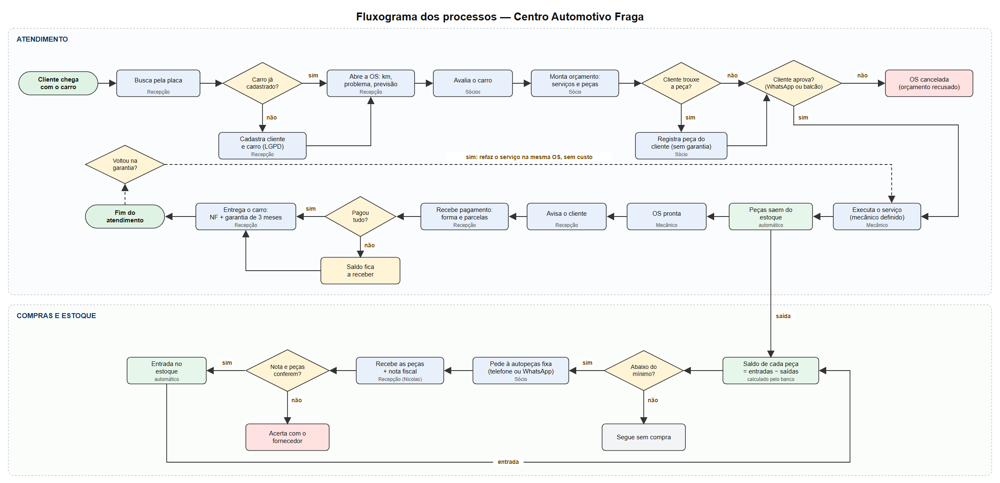
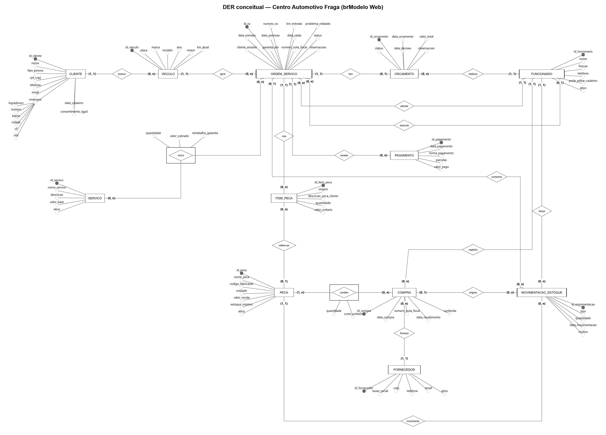
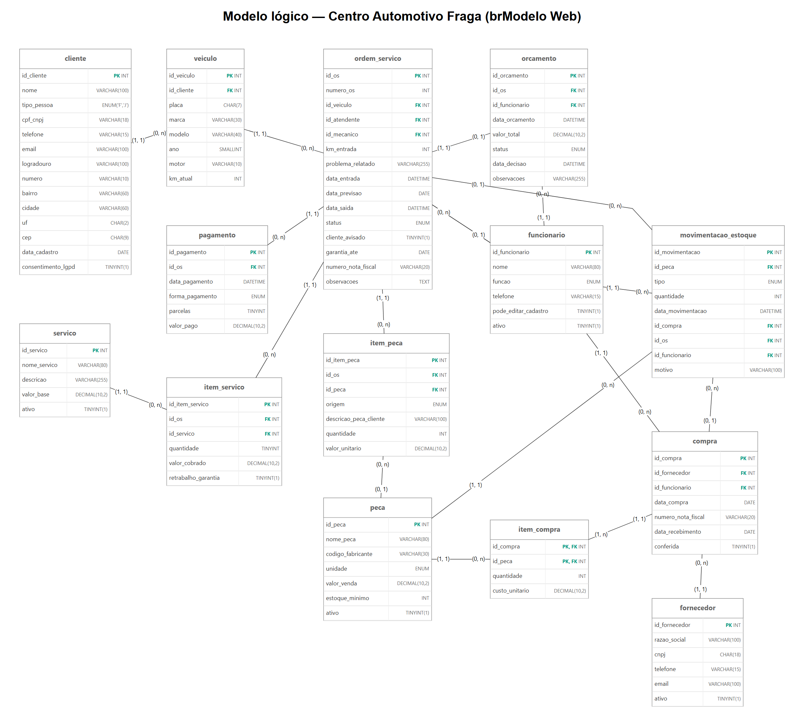

# Centro Automotivo Fraga — Banco de Dados (Entrega 2)

Modelagem de Banco de Dados · Quarta Noite · Grupo 1

Este README é o **Relatório Técnico Final** da Entrega 2. Os demais artefatos estão em arquivos separados:

| Artefato | Arquivo |
| :--- | :--- |
| DER conceitual revisado | [diagramas/der-conceitual.png](diagramas/der-conceitual.png) |
| Modelo lógico | [diagramas/modelo-logico.png](diagramas/modelo-logico.png) |
| Script SQL completo + massa de dados | [docs/script.sql](docs/script.sql) |
| Gerador da massa de dados | [docs/gerar_massa.py](docs/gerar_massa.py) |
| Dicionário de dados | [docs/dicionario-de-dados.md](docs/dicionario-de-dados.md) |
| Levantamento | [levantamento/levantamento.md](levantamento/levantamento.md) |
| Fluxograma dos processos | [diagramas/fluxograma-processos.png](diagramas/fluxograma-processos.png) |
| Evidências | [evidencias/](evidencias/) |
| Slides do pitch (8 min) | [apresentacao/pitch-fraga.pptx](apresentacao/pitch-fraga.pptx) |
| Entrega 1 (como foi entregue) | [historico-entrega-1/](historico-entrega-1/) — README, DER e fluxograma originais |
| Extra: Sistema da Oficina | [extra/sistema-oficina/](extra/sistema-oficina/) — telas para usar o banco sem SQL ([manual](extra/sistema-oficina/MANUAL.md)) |

### Integrantes

| Nome completo do aluno | RGM | Usuário do GitHub |
| :--- | :--- | :--- |
| Diego Pignatari Pereira | 47515741 | [diegopignatari06](https://github.com/diegopignatari06) |
| Guilherme da Costa Silva | 04900988-5 | [Guicosta00](https://github.com/Guicosta00) |
| João Pedro Fermiano Antunes | 04971661-1 | [joaofermiano](https://github.com/joaofermiano) |
| Mayra Anisio da Gama | 48814857 | [Gamask007](https://github.com/Gamask007) |

&nbsp;

## 1. Relatório Técnico Final

### 1.1 Revisão do Modelo Conceitual

**Caso A:** a organização é a mesma da Entrega 1, cuja existência foi confirmada na correção.

#### Caracterização da organização

- **Nome e natureza.** Centro Automotivo Fraga, oficina mecânica de manutenção de automóveis em geral. Empresa com fins lucrativos.
- **Contexto e porte.** São 11 anos de mercado e 9 pessoas: 3 sócios, 1 recepcionista e 5 funcionários na execução. A oficina faz de **6 a 8 atendimentos por dia**, cerca de **132 a 180 OS por mês**. Atende a vizinhança do Jardim Nossa Sra. do Carmo e de Itaquera (zona leste de São Paulo).
- **Problemas de gestão de informações:**
  - **P1 — Sem controle de estoque.** Não se sabe quanto há de cada peça, quanto saiu nem quando comprar. Peças faltam no meio do serviço.
  - **P2 — Peça do cliente e peça da oficina se misturam.** A mão de obra tem 3 meses de garantia, mas a peça trazida pelo cliente não tem. Sem esse registro, não dá para saber o que está coberto.
  - **P3 — Perda de informações e cadastros errados.** Já houve veículos cadastrados errado e histórico sumido, por causa do lançamento manual.
  - **P4 — Sem controle de pagamento parcial.** A oficina aceita entrada, parcelamento e pagamento em etapas, mas não registra quanto foi pago e quanto falta.

  A falta de PDF do orçamento, citada na Entrega 1, é um recurso de software, não um problema de gestão de informações. Por isso saiu da lista. Mesmo assim, a consulta de extrato da OS (`script.sql`, seção 5) entrega o conteúdo que hoje vai por captura de tela.
- **Escopo do sistema.** O banco reúne todos os dados da oficina: clientes e veículos, atendimento (OS, orçamento, serviços, peças, pagamentos), equipe, compras e estoque. Agendamento e contas a pagar ficaram de fora; a justificativa está em [Processos](#processos-de-negócio).
- **Justificativa da escolha.** A oficina tem várias pessoas em etapas diferentes do atendimento (recepção, avaliação, orçamento, execução), o que torna o mapeamento de processos rico. Ela também já usa um sistema antigo e cheio de falhas, um bom caso para propor um modelo de dados completo. **Vínculo declarado:** o integrante João Pedro Fermiano Antunes trabalha na oficina. O vínculo facilitou o acesso, mas a entrevista foi feita com o responsável (Nicolas), no local, com os quatro integrantes.
- **Evidências:**
  - Google Maps / Meu Negócio: https://share.google/ZSJaoqi0CiMngDXDz
  - Endereço: Av. Osvaldo Pucci, 665 — Jardim Nossa Sra. do Carmo, São Paulo/SP, 08270-700
  - Telefone: (11) 2521-3689 · WhatsApp: (11) 94711-4629
  - Foto da visita (arquivo no repositório): [evidencias/foto-visita-2026-09-11.jpg](evidencias/foto-visita-2026-09-11.jpg). A mesma foto também está no anexo usado na Entrega 1: https://github.com/user-attachments/assets/61b5e699-b0f4-4de8-b465-553e03a7b20f

    
- **Responsável pela organização:** Nicolas, recepcionista e responsável pelos cadastros e pelo sistema da oficina — (11) 95310-5009.

#### Relato da entrevista

- **Quem.** Entrevistado: Nicolas (recepcionista). Participaram os quatro integrantes: Mayra Anisio da Gama, João Pedro Fermiano Antunes, Diego Pignatari Pereira e Guilherme da Costa Silva.
- **Quando e onde.** 11/09/2026, à tarde, na própria oficina (Av. Osvaldo Pucci, 665), como mostra a foto em `evidencias/`. Não houve segunda visita: os pontos novos da Entrega 2 (compras, nota fiscal, agendamento, aprovação do orçamento) foram confirmados depois pelo grupo com a oficina.
- **O que foi levantado.** Fluxo do atendimento, responsáveis por etapa, catálogo de serviços, formas de busca, regras de garantia e retrabalho, troca de dono, permissões e os problemas P1 a P4. O que foi dito e o que foi observado estão separados no [levantamento](levantamento/levantamento.md), seções 3 e 4.
- **O que mudou desde a Entrega 1.** Entraram o ciclo de compras, os funcionários como entidade, a aprovação do orçamento e a separação entre peça do cliente e peça da oficina. As respostas confirmadas depois da visita estão na seção 7 do levantamento.

#### Processos de negócio

| Processo | Como acontece (dados envolvidos) |
| :--- | :--- |
| Cadastro de cliente e veículo | A recepção busca pela placa. Se não houver cadastro, registra o cliente (nome, CPF/CNPJ, telefone, e-mail, endereço, consentimento LGPD) e o veículo (placa, marca, modelo, ano, motor, km). |
| Abertura da OS | A recepção abre a OS com número, veículo, km de entrada, problema relatado, data/hora de entrada e previsão. Status `aberta`. |
| Avaliação e orçamento | Um sócio avalia e registra o orçamento (data, valor total, observações). Status `aguardando_aprovacao`. |
| Aprovação do orçamento | O cliente aprova ou recusa. Fica registrada a data da decisão. Aprovado: a OS vai para `em_execucao`, com o mecânico definido. Recusado: `cancelada`. O cliente aprova pelo WhatsApp (onde recebe o orçamento) ou pessoalmente no balcão. |
| Execução | O mecânico executa os serviços do catálogo (quantidade e valor cobrado) e usa peças, da oficina (com valor; dá baixa no estoque) ou do cliente (só a descrição). |
| Liberação e aviso | A OS fica `pronta` e a recepção avisa o cliente (`cliente_avisado`). |
| Recebimento | Um ou mais pagamentos por OS, com data, forma (dinheiro, Pix, débito, crédito), parcelas e valor. O saldo é calculado. |
| Entrega e garantia | Na retirada, ficam registrados a data de saída, a garantia até (+3 meses) e o número da nota fiscal. Status `entregue`. |
| Retrabalho em garantia | Volta na mesma OS: novo item de serviço marcado como retrabalho, valor 0, mais uma observação; a data de entrada não muda. |
| Compra de peças | A oficina pede as peças a autopeças fixas da região, por telefone ou WhatsApp. Registra-se a compra (fornecedor, data, itens com quantidade e custo). |
| Recebimento de peças | Na chegada, a recepção (Nicolas) confere a nota e as peças. A compra recebe NF, data de recebimento e conferência, e cada item gera uma entrada no estoque. |
| Controle de estoque | O saldo de cada peça é a soma das entradas e saídas. A consulta G01 mostra o que está abaixo do mínimo. |
| Cadastro de fornecedores | A oficina mantém as autopeças fixas da região cadastradas (razão social, CNPJ, telefone, e-mail, ativo). Só se compra de fornecedor cadastrado (RN11). |
| Responsáveis por etapa | Cada etapa registra quem fez: o atendente abre a OS, um sócio faz o orçamento, o mecânico executa, e a recepção registra compras e lança o estoque. Só a recepção e o sócio autorizado cadastram e alteram dados (RN06). |

**Fluxograma** (atendimento integrado a compras e estoque):



O fluxograma da Entrega 1 está em [historico-entrega-1/fluxograma-entrega-1.jpg](historico-entrega-1/fluxograma-entrega-1.jpg).

**Processos típicos não incluídos.**
- **Agendamento:** a oficina não agenda; atende por ordem de chegada.
- **Contas a pagar e caixa:** o sistema atual não controla; isso fica com os sócios e o contador. O modelo cobre o recebimento das OS e o custo das compras, que são a base para isso no futuro.

#### Requisitos

**Funcionais**

| Código | Requisito |
| :--- | :--- |
| RF01 | Cadastrar cliente com nome, tipo de pessoa, CPF/CNPJ, telefone, e-mail, endereço (logradouro, número, bairro, cidade, UF, CEP), data de cadastro e consentimento LGPD. |
| RF02 | Cadastrar veículo com placa, marca, modelo, ano, motor e km atual, vinculado a um cliente; permitir trocar o dono mantendo o histórico de OS. |
| RF03 | Buscar por placa (histórico completo de OS do veículo), por parte do nome do cliente (todos os veículos dele) e por CPF/CNPJ. |
| RF04 | Abrir OS com número, veículo, atendente, km de entrada, problema relatado, data de entrada e previsão; acompanhar o status até a entrega. |
| RF05 | Registrar orçamento da OS com sócio responsável, data, valor total e decisão do cliente (aprovado/recusado e data). |
| RF06 | Lançar na OS os serviços do catálogo (quantidade, valor cobrado, retrabalho) e as peças (da oficina ou do cliente, quantidade e valor unitário). |
| RF07 | Relatório de peças usadas por mês, com quantidade, número de OS e modelos/motores dos veículos. |
| RF08 | Registrar pagamentos da OS (data, forma, parcelas, valor) e mostrar o saldo a receber. |
| RF09 | Cadastrar fornecedores e registrar compras com itens (peça, quantidade, custo), NF, recebimento e conferência. |
| RF10 | Controlar o estoque por entradas e saídas, mostrando o saldo e as peças abaixo do estoque mínimo. |
| RF11 | Registrar na entrega a data de saída, a garantia e o número da nota fiscal. |
| RF12 | Emitir o extrato da OS (serviços e peças com valores) para enviar ao cliente. |

**Não funcionais**

| Código | Requisito |
| :--- | :--- |
| RNF01 | Integridade: placa, CPF/CNPJ e número da OS únicos; valores e quantidades validados no banco (CHECK), para evitar os cadastros errados de P3. |
| RNF02 | Segurança: só usuários com permissão de cadastro inserem ou alteram dados (papéis no MySQL). |
| RNF03 | Privacidade (LGPD): relatórios gerenciais sem CPF; consentimento registrado. |
| RNF04 | Desempenho: busca por placa e por nome em menos de 1 segundo, com índices em `placa`, `nome` e `data_entrada`. |
| RNF05 | Portabilidade: banco em MySQL 8, com `utf8mb4`, que permite exportar para planilha/PDF por ferramentas comuns. |

**Requisitos típicos não incluídos:** agendamento on-line, envio automático de WhatsApp e app para o cliente. São recursos de software que dependem de processos que a oficina não tem hoje (não há agendamento, e o aviso ao cliente é feito pela recepção).

#### Regras de negócio

| Código | Regra | Onde é garantida |
| :--- | :--- | :--- |
| RN01 | Toda OS tem número único, veículo, atendente, km, problema relatado, data de entrada e status; OS entregue tem data de saída. | NOT NULL, `uq_os_numero`, `ck_os_entregue` · A01 |
| RN02 | O serviço só é executado depois que o cliente aprova o orçamento, e o valor aprovado é o valor cobrado. | `orcamento.status` · A02, A03 |
| RN03 | Aceita dinheiro, Pix, débito e crédito; parcelamento só no crédito (até 12x); uma OS pode ter vários pagamentos, que somam no máximo o total. | `ck_pagamento_parcelas` · A04 |
| RN04 | A mão de obra tem 3 meses de garantia a partir da saída; peça trazida pelo cliente não é cobrada e não tem garantia. | `ck_item_peca_origem` · A05 |
| RN05 | Retrabalho em garantia usa a mesma OS, sem custo, com observação, e não altera a data de entrada. | `ck_item_servico_retrabalho` · A06 |
| RN06 | Só a recepção e o sócio autorizado cadastram e alteram dados. | `funcionario.pode_editar_cadastro`, papéis · A09 |
| RN07 | Na troca de dono, o veículo passa para o novo cliente e o histórico de OS continua com o veículo. | FK `veiculo.id_cliente` (UPDATE) |
| RN08 | Placa e CPF/CNPJ não se repetem; a placa segue o padrão antigo ou Mercosul. | `uq_veiculo_placa`, `uq_cliente_cpf_cnpj`, `ck_veiculo_placa` |
| RN09 | Todo serviço do catálogo tem preço de referência maior que zero. | `ck_servico_valor` |
| RN10 | Só sai do estoque o que há em saldo. | trigger `tg_mov_saldo_nao_negativo` · A07 |
| RN11 | Compra só de fornecedor cadastrado (autopeças fixas); a peça entra no estoque depois que a recepção confere nota e peças. | FK `compra.id_fornecedor`, `ck_compra_conferida` · A08 |
| RN12 | Peça abaixo do estoque mínimo deve ser comprada. Hoje o mínimo é controlado "de cabeça"; os valores de `estoque_minimo` são proposta do grupo, a validar com os sócios. | `peca.estoque_minimo` · G01 |
| RN13 | A nota fiscal de serviço é emitida em toda entrega de veículo. | `ordem_servico.numero_nota_fiscal` · A01 |
| RN14 | LGPD: dados pessoais só com consentimento registrado e com acesso restrito. | `cliente.consentimento_lgpd` · A10 |
| RN15 | Orçamento só é feito por sócio. | A09 |
| RN16 | O mecânico responsável é um funcionário cadastrado. | FK `id_mecanico` |
| RN17 | Atendimento por ordem de chegada: a OS registra data e hora de entrada, e os carros são atendidos nessa ordem (não há agendamento). | `ordem_servico.data_entrada` NOT NULL, índice `ix_os_data_entrada`; painel da recepção ordenado por entrada |

**Tipos de regra.**
- **Operacionais:** RN01–RN05, RN07–RN12, RN16 e RN17.
- **Restrições legais:** RN13 (nota fiscal de serviço) e RN14 (LGPD).
- **Restrições organizacionais da oficina:** RN06 (só a recepção e o sócio autorizado alteram dados) e RN15 (orçamento só por sócio).

**Regras típicas não incluídas.**
- **Agendamento e prioridade de atendimento:** a oficina não agenda e não dá prioridade; vale a ordem de chegada (RN17).
- **Regra da Entrega 1 que saiu:** os limites de km do veículo. O próprio grupo já tinha registrado que não é controle da oficina, e sim referência do fabricante.

#### DER conceitual revisado

- **Arquivo:** [diagramas/der-conceitual.png](diagramas/der-conceitual.png)
- **Software:** brModelo Web ([app.brmodeloweb.com](https://app.brmodeloweb.com)), modelo "Fraga - DER conceitual" na conta do grupo. O arquivo do modelo está em [diagramas/brmodelo-web/der-conceitual.json](diagramas/brmodelo-web/der-conceitual.json).
- **Entidades:** CLIENTE, VEICULO, FUNCIONARIO, ORDEM_SERVICO, ORCAMENTO, SERVICO, ITEM_PECA, PECA, PAGAMENTO, FORNECEDOR, COMPRA, MOVIMENTACAO_ESTOQUE. Entidades associativas: ITEM_SERVICO (OS × SERVICO) e ITEM_COMPRA (COMPRA × PECA).



**Apontamentos da correção da Entrega 1**

| Apontamento da correção da E1 | O que mudou no trabalho | Por quê |
| :--- | :--- | :--- |
| DER: ORÇAMENTO solto; o losango "possui" terminava na linha de PEÇA | ORÇAMENTO ligado à OS pelo relacionamento "tem": OS (1,1) — ORÇAMENTO (0,1). DER redesenhado no brModelo Web, com (mín, máx) dos dois lados. | O texto já dizia OS 1 : 0..1 Orçamento, mas o desenho não batia. |
| DER: Serviço–OS e Peça–OS N:N sem atributos (quantidade, valor praticado) | Criadas a associativa ITEM_SERVICO (quantidade, valor_cobrado, retrabalho_garantia) e a entidade ITEM_PECA (quantidade, valor_unitario, origem). | Sem elas não se sabe quanto foi cobrado nem quais peças saíram em cada OS. |
| DER: FUNCIONÁRIO ausente (essencial) | Criada FUNCIONARIO, com os papéis atende, executa, elabora (orçamento), registra (compra) e lança (estoque). | Resolve a permissão por função (RN06), a alocação de mecânicos e a rastreabilidade de quem fez o quê. |
| DER: FORNECEDOR / COMPRA ausentes | Criadas FORNECEDOR, COMPRA, ITEM_COMPRA e MOVIMENTACAO_ESTOQUE, mais `estoque_minimo` em PECA. | P1 (estoque) é o principal problema da oficina; sem compras e movimentações não existe estoque de verdade. |
| Processos: cobertura de 50%, ciclo de compras ausente | Processos reescritos com os dados envolvidos, incluindo aprovação do orçamento, recebimento, garantia, compras, recebimento de peças e estoque; agendamento e contas a pagar justificados. | O esqueleto exige incluir todos os processos existentes e justificar os ausentes. |
| Regras: cobertura de 67%, sem restrição organizacional real | Regras numeradas RN01–RN17, separadas em operacionais, legais e organizacionais, com as de compras (RN11), nota fiscal (RN13), estoque (RN10, RN12) e LGPD (RN14); saiu a regra de km do fabricante. | As regras são citadas pelas restrições do script e pelas auditorias A01–A10. |
| Dicionário de dados não atendido | Novo [dicionário](docs/dicionario-de-dados.md) separado: convenções, relacionamentos com cardinalidade, fluxo de dados, expressão formal, leitura, tipo físico, obrigatoriedade, índices, log de acesso, acesso por operação e LGPD; prefixos-padrão (`id_`, `data_`, `nome`). | Faltavam 5 dos 6 itens obrigatórios. |
| Uso de IA parcial: Uso 1 sem justificativa e reflexão; prompts descritos | Uso 1 completado e prompts transcritos na seção 6. | O uso de IA incompleto é penalizado. |
| Entrevista: o README só mostrava a foto | Relato da entrevista acima e [levantamento](levantamento/levantamento.md) separado em "dito" e "observado". | É item obrigatório da seção 1.1. |
| Foto e imagens eram anexos do GitHub | Foto salva como JPG em `evidencias/` e diagramas como PNG em `diagramas/`, referenciados por caminho relativo. | Foto fora do repositório não é aceita. |
| Justificativa técnica redigida pela IA, "o grupo ainda revisaria" | Justificativas reescritas na seção 1.5 com base nas decisões deste modelo e revisadas pelo grupo. | O professor registrou isso nas observações; vai cair na defesa oral. |
| README mantinha "Critérios Atitudinais" e "Resumo dos Pesos" do esqueleto | Seções removidas. | São instruções do professor, não conteúdo do grupo. |
| Atributo `responsavel` (texto) na OS; `pronto` e `avisado` separados | `responsavel` virou FK para FUNCIONARIO (`id_atendente`, `id_mecanico`); `pronto` foi absorvido pelo `status` (valor `pronta`) e `avisado` virou `cliente_avisado`. | O status único cobre todo o ciclo da OS; o aviso continua separado porque pode estar pronto sem o cliente saber. |
| Atributo `saldo` em PAGAMENTO; `quantidade` e `origem` em PEÇA | `saldo` saiu (é calculado na `vw_total_os`); a quantidade em estoque virou a soma das movimentações (`vw_saldo_estoque`); `origem` foi para ITEM_PECA. | São valores derivados (3FN). A origem é de cada uso da peça, não da peça do catálogo. |

### 1.2 Conversão do Modelo Conceitual para o Modelo Lógico

- **Entidades → tabelas.** Cada entidade virou uma tabela com o mesmo nome em minúsculas (`cliente`, `ordem_servico`…). As entidades ITEM_PECA e MOVIMENTACAO_ESTOQUE viraram tabelas com PK própria.
- **Atributos → colunas.** Os atributos simples viraram colunas tipadas (dicionário, seção 4). O atributo composto `endereco` foi decomposto em `logradouro`, `numero`, `bairro`, `cidade`, `uf` e `cep`. Os atributos derivados (saldo do estoque, total e saldo da OS) não viraram colunas: estão nas views.
- **Relacionamentos 1:N.** A FK fica no lado N: `veiculo.id_cliente`, `ordem_servico.id_veiculo`, `pagamento.id_os`, `compra.id_fornecedor`, `movimentacao_estoque.id_peca`. Quando o lado 1 é opcional (0,1), a FK aceita nulo: `ordem_servico.id_mecanico`, `item_peca.id_peca`, `movimentacao_estoque.id_compra` e `.id_os`.
- **Relacionamento 1:1 (OS — Orçamento, 1 : 0..1).** A FK fica no lado opcional (`orcamento.id_os`), com `UNIQUE` para garantir no máximo um orçamento por OS. Ficar em `ordem_servico` deixaria a coluna nula em toda OS sem orçamento.
- **Relacionamentos N:N.** OS × SERVICO virou `item_servico`, com PK própria (`id_item_servico`), porque o mesmo serviço pode voltar na mesma OS como retrabalho. COMPRA × PECA virou `item_compra`, com **PK composta** (`id_compra`, `id_peca`), porque a mesma peça não se repete numa compra.
- **Dois papéis com a mesma entidade.** FUNCIONARIO atende e executa a OS. Viraram duas FKs com nomes de papel: `id_atendente` e `id_mecanico`.
- **Generalização/especialização.** Não há no DER. Sócio, recepcionista e mecânico têm os mesmos atributos e foram tratados por `funcionario.funcao`.

### 1.3 Chaves Primárias e Estrangeiras

| Tabela | PK | FKs |
| :--- | :--- | :--- |
| cliente | id_cliente | — |
| veiculo | id_veiculo | id_cliente → cliente |
| funcionario | id_funcionario | — |
| ordem_servico | id_os | id_veiculo → veiculo · id_atendente → funcionario · id_mecanico → funcionario |
| orcamento | id_orcamento | id_os → ordem_servico (UNIQUE) · id_funcionario → funcionario |
| servico | id_servico | — |
| item_servico | id_item_servico | id_os → ordem_servico · id_servico → servico |
| peca | id_peca | — |
| item_peca | id_item_peca | id_os → ordem_servico · id_peca → peca |
| fornecedor | id_fornecedor | — |
| compra | id_compra | id_fornecedor → fornecedor · id_funcionario → funcionario |
| item_compra | (id_compra, id_peca) | id_compra → compra · id_peca → peca |
| movimentacao_estoque | id_movimentacao | id_peca → peca · id_compra → compra · id_os → ordem_servico · id_funcionario → funcionario |
| pagamento | id_pagamento | id_os → ordem_servico |

### 1.4 Processo de Normalização

**1FN — sem atributos multivalorados nem compostos.**
- O `endereco` da Entrega 1 era um texto único. Virou `logradouro`, `numero`, `bairro`, `cidade`, `uf` e `cep`, o que permite filtrar clientes por bairro.
- Os serviços e as peças de uma OS seriam um grupo repetitivo dentro da OS ("troca de óleo, pastilhas, alinhamento…"). Viraram linhas em `item_servico` e `item_peca`.
- Um cliente com vários telefones ou veículos não guarda listas: veículos são linhas em `veiculo`. O cadastro da oficina usa um telefone por cliente (confirmado com a oficina), então não há atributo multivalorado.

**2FN — sem dependência parcial da chave.**
- Em `item_compra` (PK `id_compra` + `id_peca`), `quantidade` e `custo_unitario` dependem da chave inteira. O nome e o preço de venda da peça dependem só de `id_peca`, por isso ficam em `peca`. A data e o fornecedor dependem só de `id_compra`, por isso ficam em `compra`.
- Antes da normalização, um "item da OS" com chave (OS, serviço) guardaria também a placa e o nome do serviço, que dependem só de parte da chave. Eles ficaram em `ordem_servico`/`veiculo` e em `servico`.

**3FN — sem dependência transitiva.**
- `pagamento.saldo` (Entrega 1) dependia do total da OS e dos pagamentos, não da chave do pagamento. Foi removido e passou a ser calculado em `vw_total_os.saldo_devedor`.
- A quantidade em estoque guardada em `peca` dependeria das movimentações. Foi trocada pela soma das entradas e saídas (`vw_saldo_estoque`).
- Os dados do cliente (nome, telefone) não se repetem na OS: a OS aponta para o veículo, e o veículo para o cliente.
- A `origem` da peça (cliente/oficina) não dependia de `id_peca`, mas de cada uso. Saiu de `peca` e foi para `item_peca`.

**Justificativa.** No caso da oficina, cada forma normal resolve um problema declarado. A 1FN permite listar as peças de cada OS (P1, P2). A 2FN evita reescrever o nome e o preço da peça em cada compra. A 3FN garante que saldo de estoque e saldo devedor nunca fiquem desatualizados (P1, P4): eles são calculados, nunca digitados.

**Desnormalização consciente.** `orcamento.valor_total` poderia ser calculado pelos itens, mas fica guardado porque é o valor **aprovado pelo cliente** naquele momento (RN02). A auditoria A03 confere se o cobrado bate com ele.

### 1.5 Justificativas Técnicas das Decisões

**Chaves primárias.** Todas as tabelas usam chave substituta numérica (`INT UNSIGNED AUTO_INCREMENT`). Os candidatos naturais mudam ou podem faltar: a placa muda de padrão (Mercosul), o CPF pode ser corrigido, e o número da OS é impresso e pode ter série nova. Esses candidatos viraram `UNIQUE`. Exceção: `item_compra` usa PK composta (`id_compra`, `id_peca`), porque essa combinação já identifica o item e impede repetir a peça na mesma compra.

**Chaves estrangeiras.**
- `ON DELETE RESTRICT` nos cadastros (cliente, veículo, funcionário, peça, fornecedor): não se apaga quem tem histórico. Isso atende P3 (perda de informação).
- `ON DELETE CASCADE` só nas partes que não existem sem o todo: `orcamento`, `item_servico` e `item_peca` da OS, e `item_compra` da compra.
- `pagamento` e `movimentacao_estoque` usam RESTRICT, porque são registros financeiros e de estoque que não podem sumir junto com a OS.

**Restrições e regras de negócio.**

| Restrição | Implementa |
| :--- | :--- |
| `uq_veiculo_placa`, `ck_veiculo_placa`, `uq_cliente_cpf_cnpj`, `ck_cliente_doc` | RN08 — sem placa ou documento repetido ou mal digitado (P3) |
| `uq_os_numero`, NOT NULL na OS, `ck_os_entregue`, `ck_os_datas` | RN01 |
| `uq_orcamento_os`, `ck_orcamento_decisao` | RN02 — um orçamento por OS, com data da decisão |
| `ck_pagamento_parcelas`, `ck_pagamento_valor` | RN03 |
| `ck_item_peca_origem` | RN04 — peça do cliente sem valor e fora do catálogo/estoque (P2) |
| `ck_item_servico_retrabalho` | RN05 — retrabalho sempre com valor zero |
| `ck_servico_valor` | RN09 |
| trigger `tg_mov_saldo_nao_negativo`, `ck_mov_origem` | RN10 — saída só com saldo; toda movimentação tem origem (compra, OS ou motivo) |
| `ck_compra_conferida`, `ck_compra_datas` | RN11 |
| `ck_cliente_lgpd`, DEFAULT 0 em `consentimento_lgpd` | RN14 — sem consentimento até ser registrado |

**Decisões arquiteturais.**
- O estoque é um **livro de movimentações** (cada entrada e saída é uma linha), e não um número que se edita. Isso dá histórico, permite auditoria e ataca P1 na raiz.
- O **status único** da OS substitui `pronto`, que poderia contradizer outros campos.
- As **views** (`vw_saldo_estoque`, `vw_total_os`) concentram os cálculos usados pelas consultas G e A, para que todos os relatórios usem a mesma fórmula.
- Charset `utf8mb4` para nomes com acento. Índices nas buscas do balcão: `placa` (UNIQUE), `cliente.nome`, `ordem_servico.data_entrada` e `status`.

### 1.6 Proposta de Arquitetura Analítica para BI e IA

**Informações estratégicas:** quanto a oficina fatura e por qual forma; quais serviços e peças movem o negócio; quanto há a receber; quais peças faltam; quanto tempo o carro fica parado; quanto retrabalho acontece.

**KPIs** (período: mês). Os sócios não têm metas formais hoje: as metas abaixo são **propostas pelo grupo**, a validar com eles.

| KPI | Fórmula | Valor na massa (set/2026) | Meta sugerida |
| :--- | :--- | :--- | :--- |
| Faturamento recebido | soma de `pagamento.valor_pago` no mês | R$ 67.102,40 | ≥ R$ 70 mil/mês |
| Ticket médio por OS | média de `vw_total_os.total_os` das OS entregues | R$ 559,48 (124 OS) | ≥ R$ 550 |
| Peças abaixo do mínimo | contagem em `vw_saldo_estoque` com saldo < mínimo | 4 peças | 0 |
| Valor a receber | soma de `saldo_devedor` das OS prontas/entregues | 15 OS entregues com saldo | ≤ 5% do faturamento |
| % de itens de peça trazidos pelo cliente | itens origem cliente ÷ total de itens | 9,7% (G04) | acompanhar |
| Tempo médio de permanência | média de horas entre `data_entrada` e `data_saida` | por mecânico, ver G10 | ≤ 48 h |
| Taxa de retrabalho em garantia | OS com retrabalho ÷ OS entregues | 4,8% | < 3% |
| Taxa de aprovação de orçamentos | aprovados ÷ decididos | 97,8% | acompanhar |
| Mix de serviços | quantidade e receita por serviço | troca de óleo lidera (G12) | — |

**Potencial para BI.** Os dados já estão em formato de fatos e dimensões. Os fatos são OS, itens, pagamentos e movimentações, todos com data. As dimensões são cliente, veículo (marca, modelo, motor, ano), serviço, peça, funcionário e fornecedor. As views podem alimentar um painel (Power BI, Metabase ou Looker Studio) com faturamento por mês, ranking de serviços, estoque crítico e contas a receber.

**Aplicações de IA.**
- **Previsão de demanda de peças:** usar a série de saídas por peça e por mês (G02) para sugerir o estoque mínimo, em vez de um número fixo.
- **Lembrete de manutenção:** pela km e pela data da última troca de óleo/correia de cada veículo, prever o próximo retorno e avisar o cliente.
- **Estimativa de orçamento e de prazo:** com o histórico de serviços × modelo × motor, sugerir valor e tempo.
- **Detecção de anomalias:** OS com valor muito diferente da média do serviço, ou retrabalho concentrado num tipo de serviço.

**Rastreabilidade**

| Problema ou KPI | Tabelas envolvidas | Consulta no script |
| :--- | :--- | :--- |
| P1 — sem controle de estoque | PECA, MOVIMENTACAO_ESTOQUE (vw_saldo_estoque) | G01, G02 |
| P2 — peça do cliente × peça da oficina | ITEM_PECA, ORDEM_SERVICO, VEICULO | G03, G04 |
| P3 — perda de informação / cadastro errado | VEICULO, CLIENTE, ORDEM_SERVICO | G05, G06 (e as restrições UNIQUE/CHECK) |
| P4 — pagamento parcial sem controle | PAGAMENTO, ITEM_SERVICO, ITEM_PECA (vw_total_os) | G07 |
| Faturamento recebido | PAGAMENTO | G08 |
| Ticket médio por OS | ORDEM_SERVICO, ITEM_SERVICO, ITEM_PECA | G09 |
| Peças abaixo do mínimo | PECA, MOVIMENTACAO_ESTOQUE | G01 |
| Valor a receber | vw_total_os, ORDEM_SERVICO | G07 |
| % de peças trazidas pelo cliente | ITEM_PECA | G04 |
| Tempo médio de permanência | ORDEM_SERVICO, FUNCIONARIO | G10 |
| Taxa de retrabalho e de aprovação | ITEM_SERVICO, ORDEM_SERVICO, ORCAMENTO | G11 |
| Mix de serviços / trocas de óleo | ITEM_SERVICO, SERVICO | G12 |

---

## 2. Modelo Lógico Relacional

- **Arquivo:** [diagramas/modelo-logico.png](diagramas/modelo-logico.png)
- **Software:** brModelo Web ([app.brmodeloweb.com](https://app.brmodeloweb.com)), modelo "Fraga - Modelo lógico". Ele foi gerado pelo conversor conceitual → lógico do próprio brModelo Web. Depois foi ajustado para ficar idêntico ao `docs/script.sql`: nomes das FKs (`id_atendente`, `id_mecanico`…), tipos, colunas das associativas e cardinalidades opcionais (0, 1). Arquivo do modelo: [diagramas/brmodelo-web/modelo-logico.json](diagramas/brmodelo-web/modelo-logico.json).
- As demais restrições (NOT NULL, UNIQUE, CHECK, DEFAULT) estão no [dicionário](docs/dicionario-de-dados.md) e no script.



---

## 3. Script SQL Completo

[docs/script.sql](docs/script.sql), na ordem pedida:

1. `CREATE DATABASE fraga_oficina` (utf8mb4);
2. `CREATE TABLE` das 14 tabelas, com PK, FK, NOT NULL, UNIQUE, CHECK e DEFAULT;
3. views `vw_saldo_estoque` e `vw_total_os` e o trigger de saldo (RN10);
4. `INSERT` da massa de dados;
5. `SELECT` com `JOIN` (painel da recepção e extrato da OS);
6. `UPDATE` (OS pronta e cliente avisado, troca de dono do veículo, reajuste de preço);
7. `DELETE` (pagamento em duplicidade, cadastro duplicado sem veículo);
8. consultas gerenciais **G01–G12**;
9. consultas de auditoria **A01–A10**.

**Testado do zero no MySQL 8.4.13** (banco vazio, `mysql < docs/script.sql`): roda sem erros.

**Para rodar:** no MySQL Workbench, abrir o arquivo e executar tudo (raio). Na linha de comando: `mysql -u root -p < docs/script.sql`. O script apaga e recria o banco `fraga_oficina`.

**Auditorias com resultado.** A maioria volta vazia (regra respeitada). Três apontam situações do dia a dia de propósito, para a auditoria ter o que mostrar:

- **A02:** uma OS foi executada antes de o cliente aprovar o orçamento.
- **A08:** uma compra chegou, mas ainda não foi conferida, e por isso não entrou no estoque.
- **A10:** um cliente antigo ainda sem consentimento LGPD registrado.

---

## 4. Massa de Dados

A massa está **dentro do `script.sql`** e simula **um mês de operação (setembro/2026)**. É gerada por [docs/gerar_massa.py](docs/gerar_massa.py) com semente fixa: `python docs/gerar_massa.py` reescreve o bloco de INSERTs do script. Todos os nomes, CPFs/CNPJs, placas, telefones e e-mails são **fictícios**. Os funcionários também têm nomes fictícios, com os mesmos papéis da equipe real.

| Tabela | Registros | Por que esse volume |
| :--- | ---: | :--- |
| funcionario | 9 | a equipe real: 3 sócios, 1 recepcionista e 5 na execução |
| ordem_servico | 146 | 6 a 8 atendimentos por dia útil (seg–sex) e ~3 no sábado = dentro da faixa real de 132–180/mês |
| cliente | 110 | clientes atendidos no mês mais alguns cadastrados sem OS no período (34 sem OS em setembro), para testar cliente sem movimento |
| veiculo | 132 | parte dos clientes e as empresas têm 2 veículos |
| orcamento | 142 | quase toda OS; as abertas e algumas canceladas não têm (cardinalidade 0..1) |
| item_servico | 204 | 1 a 3 serviços por OS, mais 6 retrabalhos em garantia |
| item_peca | 258 | peças dos serviços executados; 9,7% trazidas pelo cliente |
| servico / peca / fornecedor | 20 / 20 / 6 | catálogo dos serviços mais comuns; peças de giro; autopeças da região |
| compra / item_compra | 8 / 32 | reposição semanal, compras emergenciais no dia, uma compra não conferida e uma ainda não entregue |
| movimentacao_estoque | 282 | inventário inicial + entradas das compras + uma saída para cada peça da oficina usada |
| pagamento | 156 | à vista, entrada + restante, e parciais com saldo devedor |

**Variedade para os testes:** OS em todos os status (125 entregues, 5 canceladas, abertas, aguardando aprovação, em execução e prontas); orçamentos aprovados, recusados e pendentes; 4 formas de pagamento e crédito parcelado; 15 OS entregues com saldo a receber; 4 peças abaixo do mínimo; peças do cliente; retrabalhos em garantia; compras recebidas, não conferidas e não entregues; cliente sem consentimento LGPD.

---

## 5. Repositório GitHub

```
README.md                         relatório técnico (este arquivo)
docs/script.sql                   script SQL completo + massa de dados
docs/gerar_massa.py               gerador da massa (semente fixa)
docs/dicionario-de-dados.md       dicionário de dados
diagramas/der-conceitual.png      DER conceitual revisado
diagramas/modelo-logico.png       modelo lógico
diagramas/fluxograma-processos.png fluxograma dos processos
levantamento/levantamento.md      levantamento
evidencias/                       fotos da organização e da entrevista (JPG/PNG)
apresentacao/pitch-fraga.pptx     slides do pitch de 8 minutos
historico-entrega-1/              README, DER e fluxograma como entregues na Entrega 1
extra/sistema-oficina/            extra: telas para o dono usar o banco (Node.js)
```

Os commits são feitos por cada integrante com a própria conta do GitHub.

---

## 6. Uso de Inteligência Artificial

### Entrega 1

**Uso 1 — Organização e correção do README (Claude)**
- **Ferramenta e etapa:** Claude; organização do README da Entrega 1 (contato, dicionário preliminar, ortografia).
- **Motivação:** o conteúdo já tinha sido levantado na visita; faltava organizar e corrigir.
- **Prompt(s) utilizados** (reconstruídos; o texto exato não foi guardado): "Organize este README e corrija a ortografia; adicione os telefones de contato; corrija o nome do atributo cliente; explique melhor cada entidade do dicionário; marque o preço do serviço como obrigatório; ajuste a descrição do campo km; crie um nome fictício de cliente para o exemplo."
- **Resposta recebida:** reescrita dos trechos, telefones incluídos, frase explicativa antes de cada tabela, `valor_base` obrigatório, nome fictício "João da Silva Mendes".
- **Fontes consultadas e verificadas:** nenhuma externa; tudo veio da visita.
- **Trechos rejeitados ou corrigidos:** nenhum.
- **Justificativa da escolha final:** as mudanças foram de forma (organização e ortografia), sem alterar o que foi levantado na oficina, por isso foram mantidas.
- **Reflexão crítica:** o risco nesse uso era a IA "completar" informações da oficina que o grupo não informou. O grupo conferiu que nenhum dado novo foi inventado, exceto o nome fictício pedido.

**Usos 2 e 3** (alinhamento do dicionário com o DER e redação das justificativas) estão registrados no [README da Entrega 1](historico-entrega-1/README-entrega-1.md), seção 9. A Justificativa Técnica gerada naquele uso foi substituída pela seção 1.5 desta entrega.

### Entrega 2

**Uso 4 — Explicação da Entrega 2 e plano de trabalho (Claude, claude.ai)**
- **Ferramenta e etapa:** Claude (claude.ai), documento "Entrega 2 explicada — Centro Automotivo Fraga", de 28/10/2026.
- **Motivação:** entender o esqueleto da Entrega 2 e transformar a correção da Entrega 1 em lista de tarefas.
- **Prompt(s)** (reconstruído; o texto exato não foi guardado): "Explique a Entrega 2 em linguagem simples, com base neste esqueleto e na correção da Entrega 1 (issue #1), e diga o que falta no nosso repositório e o que precisamos fazer." Esqueleto e issue anexados.
- **Resposta recebida:** explicação da entrega em 7 passos, a tabela de apontamentos da correção (base da tabela da seção 1.1), a lista do que faltava no repositório, as entidades sugeridas (as 14 tabelas deste modelo) e uma divisão de tarefas.
- **Fontes verificadas:** a issue #1 de correção e o esqueleto da Entrega 2, comparados item a item.
- **Rejeitado/corrigido:** nada foi rejeitado. Os processos típicos sugeridos (compras, nota fiscal, agendamento) não foram aceitos como fato: foram confirmados depois com a oficina (agendamento não existe e ficou fora do modelo).
- **Justificativa:** a tabela de apontamentos foi mantida porque cobre todos os itens da issue #1.
- **Reflexão crítica:** a IA sugeriu processos típicos (compras, nota fiscal, agendamento) que não tinham sido levantados na visita. Por isso o grupo só os incluiu depois de confirmar com a oficina.

**Uso 5 — Rascunho do script, da massa, do dicionário, dos diagramas e deste relatório (Claude Code)**
- **Ferramenta e etapa:** Claude Code (Claude Opus), em 28/10/2026: script SQL, gerador da massa de dados, consultas G/A, dicionário, levantamento, rascunho dos diagramas em PNG e texto deste README.
- **Motivação:** a versão anterior desses arquivos, feita no claude.ai, não foi encontrada. Era preciso ter um rascunho completo e testado para o grupo revisar e dividir.
- **Prompt (transcrito):** "Crie um repositório de rascunho copiado do original, organize esses arquivos em commits pequenos por assunto, e depois levamos para a main com cada integrante usando a própria conta." Depois, nas perguntas da ferramenta, o grupo escolheu: refazer os arquivos, testar num MySQL 8 local, marcar como pendentes os fatos desconhecidos, gerar os diagramas como rascunho para redesenhar no brModelo e simular um mês (~150 OS).
- **Resposta recebida:** os arquivos deste repositório. O script foi executado do zero no MySQL 8.4.13 até rodar sem erros.
- **Fontes verificadas:** README e DER da Entrega 1, issue #1, esqueleto da Entrega 2 e a saída real do MySQL (os números das seções 1.6 e 4 vêm dessa execução).
- **Trechos rejeitados ou corrigidos durante a geração:**
  - a primeira versão das views de estoque falhava no MySQL (negativo em coluna `UNSIGNED`) e foi corrigida com `CAST`;
  - a massa repetia o óleo quando "Revisão completa" e "Troca de óleo" caíam na mesma OS; a combinação foi bloqueada e as peças repetidas foram somadas;
  - a primeira massa tinha só 1 OS cancelada (taxa de aprovação de 100%) e foi ajustada.
  - na revisão, o grupo trocou as suposições da IA pelos fatos levantados: responsável e entrevistado (Nicolas), participantes e data da visita, compras com autopeças fixas e conferência pela recepção, nota fiscal em toda entrega, ausência de agendamento, aprovação do orçamento pelo WhatsApp ou no balcão e controle de estoque "de cabeça".
- **Justificativa da escolha final:** o grupo manteve a estrutura, o script e as consultas porque foram testados e batem com o que foi levantado; mudou só o que dependia de fatos da oficina.
- **Diagramas no brModelo Web (03/11/2026):** com a conta do grupo, o Claude montou o DER no editor do brModelo Web. Ele gerou o conteúdo a partir do modelo do script e salvou pela própria página. Depois usou o conversor do site para o modelo lógico, respondendo às perguntas do assistente de conversão: FK na tabela do lado "muitos", como no script. Por fim, corrigiu o que o conversor deixou diferente do script: nomes de FK, tipos `INT` genéricos, atributos da associativa e as cardinalidades (0, 1) perdidas. Um erro do próprio Claude (FKs opcionais marcadas como PK) foi achado na conferência e corrigido antes da exportação.
- **Também gerado nesta etapa:** o fluxograma dos processos, os slides do pitch (`apresentacao/pitch-fraga.pptx`) e o sistema extra (`extra/sistema-oficina`). Durante o uso do sistema, a IA encontrou e corrigiu um erro real do script: `saldo - estoque_minimo` falhava com coluna `UNSIGNED` (erro 1690). A view passou a converter para `SIGNED`.
- **Reflexão crítica:** a IA não esteve na oficina. Tudo o que é sobre o funcionamento real e não estava na Entrega 1 ficou pendente até o grupo confirmar com a oficina. A massa é coerente com o porte, mas os preços de serviços e peças são estimativas, não a tabela real da oficina. O conversor do brModelo Web perdeu informações do conceitual (atributos da associativa, cardinalidade opcional e nomes das FKs), e o modelo lógico só ficou fiel ao script depois de conferido campo a campo. O grupo deve revisar os dois diagramas antes da defesa.

---

## 7. Apresentação Corporativa Final

Slides: [apresentacao/pitch-fraga.pptx](apresentacao/pitch-fraga.pptx). São 9 slides na ordem pedida (contexto, solução, modelo lógico, SQL rodando, consultas, BI/IA, benefícios), com notas de fala e tempos. A demonstração ao vivo usa o MySQL Workbench com G01, G07, G08, A02 e A08.

| Slides | Parte | Tempo | Quem fala |
| :--- | :--- | :---: | :--- |
| 1–2 | Abertura e contexto do problema | 0:00–1:40 | João Pedro Fermiano Antunes |
| 3–4 | Solução e modelo lógico | 1:40–3:40 | Guilherme da Costa Silva |
| 5–6 | SQL rodando e consultas G/A (opera o computador) | 3:40–6:00 | Mayra Anisio da Gama |
| 7–9 | BI e IA, benefícios e encerramento | 6:00–8:00 | Diego Pignatari Pereira |

Na defesa do modelo lógico, depois do pitch, cada pergunta é respondida por quem foi chamado.
